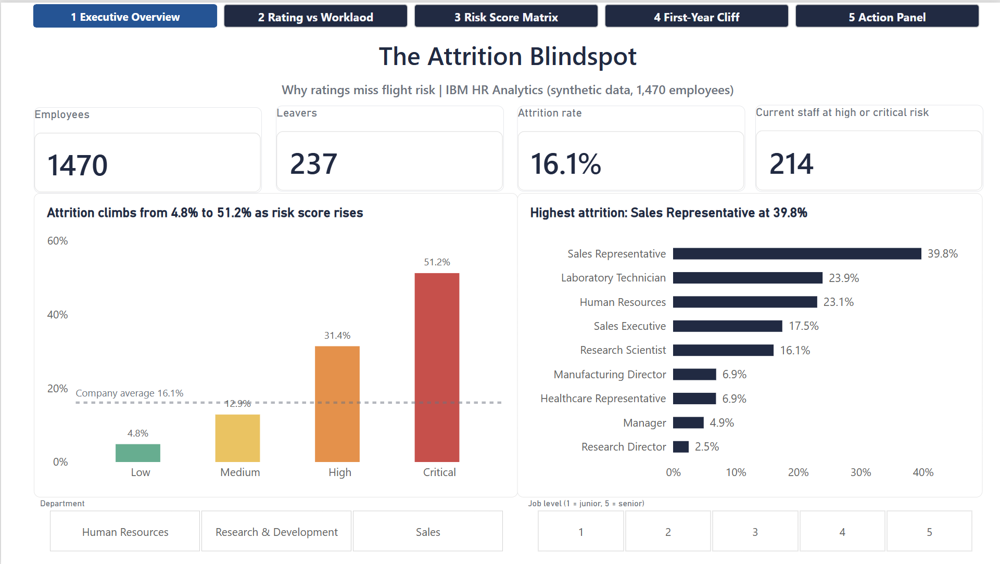
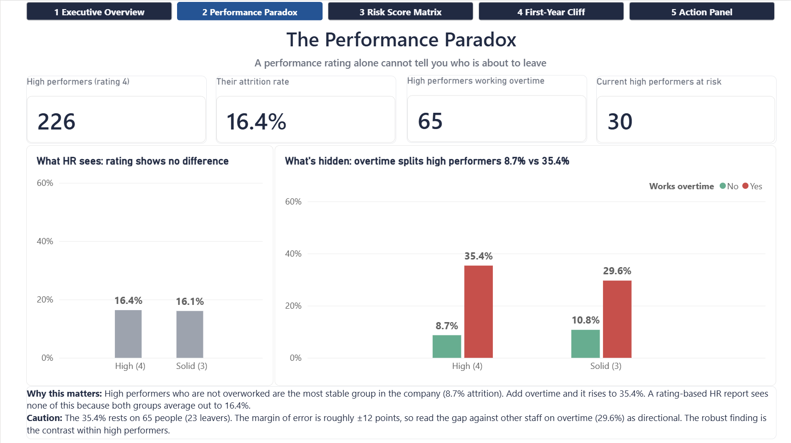
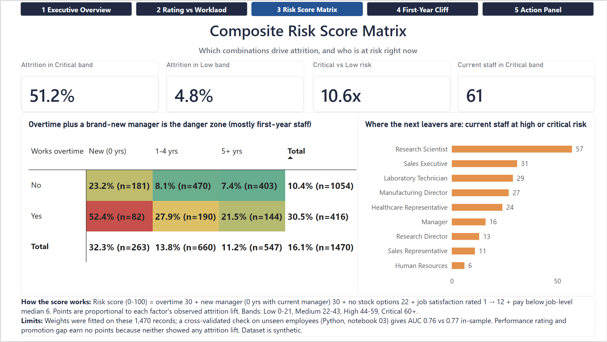
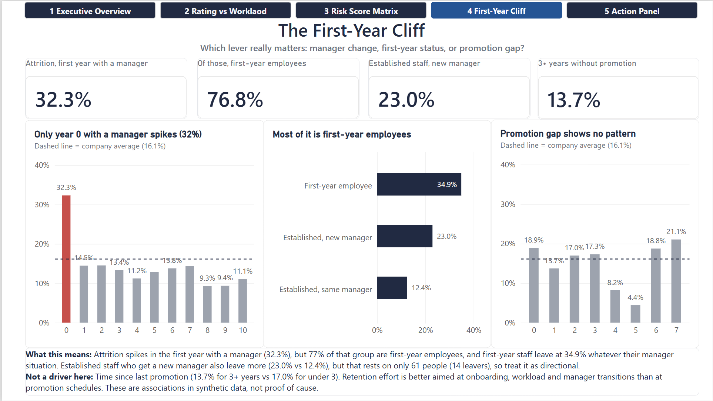
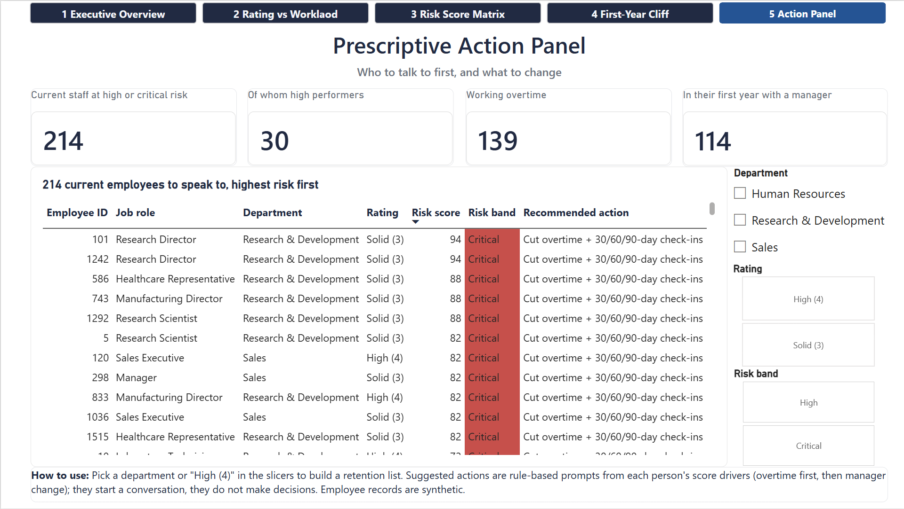

# 🔴 The Attrition Blindspot: Why Ratings Miss Flight Risk


> **Project 03** of my data analytics portfolio | IBM HR Analytics dataset (synthetic, 1,470 employees)



▶ **[Watch the 60-second walkthrough](https://drive.google.com/file/d/1VcmbR0Km_ufdjxYmLWkPizaDmutrTWv1/view?usp=drive_link)** · 📄 [Data dictionary](docs/data_dictionary.md) · 🗂 [Power BI file](powerbi/hr_attrition_blindspot.pbix) · 🧮 [SQL scripts](sql/)

---

## A Short Summary

- **Question:** can a performance rating warn HR about who is about to leave?
- **Answer:** no. High performers (rating 4) leave at 16.4% vs 16.1% for everyone else. The signal sits in **overtime** (30.5% vs 10.4%) and **first-year status** (34.9% attrition).
- **Output:** a 5-page Power BI dashboard with a transparent 0-100 risk score (attrition from **4.8% in the Low band to 51.2% in Critical**, a 10.6x spread) and a ranked action list of **214 current employees** (30 of them high performers).
- **Skills shown:** PostgreSQL (CTEs, percentiles, views, validation queries), DAX (calculated columns, measures, dynamic titles), dashboard design, hypothesis testing and honest reporting of limits.

> [!NOTE]
> The dataset is **synthetic**, created by IBM data scientists. Findings are illustrative, not evidence about a real company. See [Limitations](#limitations-read-before-quoting-any-number).

---

## Business question
Which combination of performance rating, overtime, promotion history and manager tenure creates the highest attrition risk, and can a performance rating warn HR in time?

## Headline findings

| # | Finding | Evidence | Confidence |
|---|---|---|---|
| 1 | **A performance rating carries no attrition signal.** | High performers (rating 4) leave at 16.4% vs 16.1% for everyone else (n = 226 / 1,244). | High |
| 2 | **The rating hides a workload split.** High performers who are *not* on overtime are the most stable group (8.7%, n = 161). With overtime it is 35.4% (n = 65). | 23 leavers in the overtime group; margin of error about ±12 points. | Low (directional) |
| 3 | **Overtime is the strongest single driver.** | 30.5% with overtime vs 10.4% without (n = 416 / 1,054). | High |
| 4 | **Overtime plus a brand-new manager is the danger zone.** | 52.4% attrition (n = 82), about 7x the lowest-risk cell. | Medium |
| 5 | **The "new manager" effect is mostly a first-year-employee effect.** | 77% of staff in their first year with a manager are first-year employees. First-year staff leave at 34.9% (n = 215). Established staff with a new manager: 23.0% (n = 61) vs 12.4% with the same manager. | Medium (first part), Low (established staff) |
| 6 | **Promotion gap does not predict attrition here.** | 13.7% for 3+ years since promotion vs 17.0% for under 3; no trend by year. Tested and rejected. | High |
| 7 | **A transparent 0-100 risk score separates attrition by 10.6x.** | Low band 4.8% vs Critical band 51.2%. | Medium (weights fitted in-sample) |
| 8 | **214 current employees sit in the High or Critical bands** (30 are high performers). | The largest pool is Research Scientist (57). Sales Representatives have the highest historic attrition (39.8%) but only 11 remain at risk, because most have already left. | Descriptive |

## The performance paradox
Averaged together, high performers and everyone else look identical, which is exactly why rating-based HR reports see nothing. Splitting by workload shows opposite effects that cancel out: high performers are *more* stable than others when not overworked (8.7% vs 10.8%) and *less* stable when overworked (35.4% vs 29.6%). The second gap is small-sample and should be read as directional; the robust result is the contrast within high performers.



## Composite risk score
Points are proportional to each driver's observed attrition lift (percentage points, rounded so the total is 100).

| Driver | Attrition lift | Points |
|---|---|---|
| Overtime | +20.1 | 30 |
| New manager (0 yrs with current manager) | +19.7 | 30 |
| No stock options | +14.5 | 22 |
| Job satisfaction = 1 (lowest) | +8.4 | 12 |
| Pay below job-level median | +4.6 | 6 |
| High performer / promotion gap | none | 0 |

| Risk band | Score | Employees | Leavers | Attrition |
|---|---|---|---|---|
| Low | 0-21 | 516 | 25 | 4.8% |
| Medium | 22-43 | 606 | 78 | 12.9% |
| High | 44-59 | 223 | 70 | 31.4% |
| Critical | 60+ | 125 | 64 | 51.2% |



## Dashboard pages
1. **Executive Overview**: KPIs, attrition by risk band and job role, department and job level slicers
2. **The Performance Paradox**: what HR sees vs what is hidden
3. **Composite Risk Score Matrix**: overtime x manager tenure heatmap, current at-risk staff by role
4. **The First-Year Cliff**: manager tenure, first-year effect, and the rejected promotion hypothesis
5. **Prescriptive Action Panel**: ranked list of 214 current at-risk employees with rule-based suggested actions




## What I would recommend to HR
These are hypotheses to **pilot and measure**, not proven causal fixes.

1. **Stop using the performance rating alone as a flight-risk screen.** It showed no signal (16.4% vs 16.1%). Use workload and tenure signals instead.
2. **Review overtime for the 139 at-risk employees who work it**, starting with the high performers among them. Overtime carried the largest single lift (30.5% vs 10.4%).
3. **Build a first-year retention routine.** First-year employees leave at 34.9%. Test structured 30/60/90-day manager check-ins for new hires.
4. **Add a manager-transition protocol for established staff.** Those with a new manager leave at 23.0% vs 12.4% (directional, n = 61).
5. **Do not fund promotion-timing programmes as a retention lever on this evidence.** Time since last promotion showed no relationship with attrition.
6. **Pilot a stock-option coverage review.** Employees with no stock options leave at 24.4% vs 9.9% for those with options.

## Method
1. **PostgreSQL**: loaded the raw CSV, ran data-quality checks (1,470 rows, no nulls or duplicates, three constant columns dropped), tested thresholds against the data before fixing them, and built the `hr.employees_clean` view.
2. **Threshold testing changed the design**: the planned `<= 1 year` new-manager flag became `= 0` after the data showed year 1 sits at baseline; the planned promotion-stagnation driver was removed after showing no relationship.
3. **Independent validation**: `sql/05_risk_score_validation.sql` recomputes the score and bands in SQL, so every dashboard number can be checked against a second implementation.
4. **Power BI / DAX**: calculated columns for flags, score, band and recommended action; measures for rates, cohort slices and dynamic chart titles; conditional formatting driven by a DAX colour measure.

## Repository structure
```
03-hr-attrition-blindspot/
├── data/
│   ├── raw/ibm_hr_attrition_raw.csv         original Kaggle file, unchanged
│   └── processed/hr_attrition_clean.csv     export of hr.employees_clean (39 columns)
├── docs/
│   └── data_dictionary.md                   every column, flag, score weight and measure
├── powerbi/
│   ├── hr_attrition_blindspot.pbix          5-page dashboard
│   └── screenshots/                         page screenshots used in this README
├── sql/
│   ├── 01_create_schema.sql
│   ├── 02_load_data.sql
│   ├── 03_data_quality_checks.sql
│   ├── 04_composite_risk_export.sql
│   └── 05_risk_score_validation.sql
└── README.md
```

## How to reproduce
1. Install PostgreSQL and pgAdmin, and create a database named `hr_attrition`.
2. Run `sql/01_create_schema.sql`.
3. Import `data/raw/ibm_hr_attrition_raw.csv` into `hr.employees_raw` (pgAdmin: right-click the table, **Import/Export Data**, header on). Details are in `sql/02_load_data.sql`.
4. Run `03`, `04` and `05` one query at a time (highlight the query, press F5). Expected values are written in the comments next to each query.
5. Check that the bands from script `05` match the table above (516 / 606 / 223 / 125 employees).
6. Open `powerbi/hr_attrition_blindspot.pbix` in Power BI Desktop. If it asks for the data, use **Home → Transform data → Data source settings → Change Source** and select `data/processed/hr_attrition_clean.csv`.

## Data source
IBM HR Analytics Employee Attrition & Performance dataset on [Kaggle](https://www.kaggle.com/datasets/pavansubhasht/ibm-hr-analytics-attrition-dataset). Synthetic data created by IBM data scientists. See the Kaggle page for the terms of use.

## Limitations (read before quoting any number)
- **Synthetic dataset** created by IBM data scientists. Findings are illustrative, not real-company evidence.
- **Score weights were fitted on the same 1,470 records they are tested on.** It is a prioritisation tool, not a validated forecast. A fair test would need a hold-out set or a second year of data.
- **Associations, not causes.** First-year status, overtime and manager change overlap.
- **Small cells:** the 35.4% high-performer-overtime rate (n = 65) and the 23.0% established-staff-new-manager rate (n = 61) are directional.
- Performance rating only contains 3 and 4 in this dataset, so "high performer" means rating 4 (15.4% of staff).

## More from my portfolio
- **Project 01**: [NHS Readmission Risk Analysis](https://github.com/gunasundarram/01-nhs-weekend-admissions) (SQL, Tableau)
- **Project 02**: [Olist Seller Survival Analysis](https://github.com/gunasundarram/02-olist-seller-survival) (SQL, Power BI)
