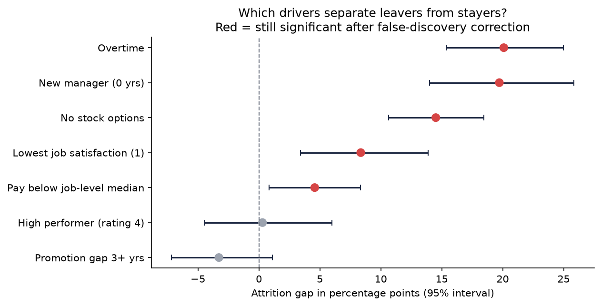
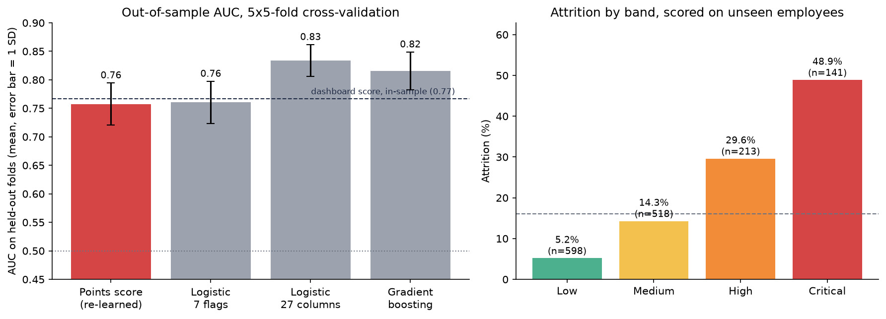

# 🔴 The Attrition Blindspot: Why Ratings Miss Flight Risk


> **Project 03** of my data analytics portfolio | IBM HR Analytics dataset (synthetic, 1,470 employees)


▶ **[Watch the 60-second walkthrough](https://drive.google.com/file/d/1NIY0nbmJo9dHF2iVBnSrmWco169R5M2J/view?usp=drive_link)** · 📄 [Data dictionary](docs/data_dictionary.md) · 🗂 [Power BI file](powerbi/hr_attrition_blindspot.pbix) · 🧮 [SQL scripts](sql/) · 🐍 [Python notebooks](notebooks/)

---

## In 30 seconds

- **Question:** can a performance rating warn HR about who is about to leave?
- **Answer:** no detectable signal. High performers (rating 4) leave at 16.4% vs 16.1% for everyone else (gap +0.3 points, 95% CI -4.5 to +6.0). The signal sits in **overtime** (30.5% vs 10.4%) and **first-year status** (34.9% attrition).
- **Output:** a 5-page Power BI dashboard with a transparent 0-100 risk score (attrition from **4.8% in the Low band to 51.2% in Critical**) and a ranked action list of **214 current employees** (30 of them high performers).
- **Checked three ways:** the numbers are reproduced in SQL and Python, every finding gets a confidence interval and a multiple-testing correction, and the score is cross-validated on unseen employees (**AUC 0.76** vs 0.77 in-sample).
- **Skills shown:** PostgreSQL (CTEs, percentiles, views, validation queries), DAX (calculated columns, measures, dynamic titles), Python (pandas, SciPy, statsmodels, scikit-learn, pytest), hypothesis testing and honest reporting of limits.

> [!NOTE]
> The dataset is **synthetic**, created by IBM data scientists. Findings are illustrative, not evidence about a real company. See [Limitations](#limitations-read-before-quoting-any-number).

---

## Business question
Which combination of performance rating, overtime, promotion history and manager tenure creates the highest attrition risk, and can a performance rating warn HR in time?

## Headline findings
Intervals are 95%. "Supported" means the result survives a Benjamini-Hochberg false-discovery correction across the tests in [notebook 02](notebooks/02_statistical_rigour.ipynb).

| # | Finding | Evidence | Verdict |
|---|---|---|---|
| 1 | **A performance rating shows no detectable attrition signal.** | High performers 16.4% (37 of 226) vs 16.1% (200 of 1,244). Gap +0.3 points, CI -4.5 to +6.0. The sample could only detect a gap of about 8 points, so a small real gap cannot be ruled out. | No detectable gap |
| 2 | **Overtime is the strongest single driver.** | 30.5% with overtime vs 10.4% without (+20.1 points, CI +15.4 to +25.0; n = 416 / 1,054). It is also the top feature in a gradient-boosting model that sees all 27 columns. | Supported |
| 3 | **Overtime raises attrition for high performers and for everyone else.** | High performers 8.7% to 35.4% (+26.7 points, CI +14.9 to +39.3). Other staff 10.8% to 29.6% (+18.9, CI +13.8 to +24.2). Whether overtime hurts high performers *more* is **not supported**: interaction odds ratio 1.64, CI 0.73 to 3.70, p = 0.23. | Overtime effect supported; "hurts them more" not supported |
| 4 | **Overtime plus a brand-new manager is the danger zone.** | 52.4% (CI 41.8% to 62.9%, n = 82) vs 14.0% for everyone else. | Supported |
| 5 | **The "new manager" effect is mostly a first-year-employee effect.** | 77% of staff in their first year with a manager are first-year employees. First-year staff leave at 34.9% (CI 28.8% to 41.5%, n = 215) vs 12.9% for established staff (+22.0 points, CI +15.6 to +28.8). Established staff with a new manager: 23.0% vs 12.4% (+10.6, CI +1.6 to +22.6, n = 61). | First-year effect supported; established-staff effect supported but imprecise |
| 6 | **Promotion gap does not predict attrition here.** | 13.7% for 3+ years since promotion vs 17.0% for under 3 (-3.3 points, CI -7.2 to +1.1, p = 0.14); no trend by year. Excluded from the score. | No detectable effect |
| 7 | **A transparent 0-100 risk score separates attrition by about 10x.** | Low band 4.8% vs Critical band 51.2% in-sample. On unseen employees: 5.2% / 14.3% / 29.6% / 48.9% (Low to Critical), AUC 0.76 vs 0.77 in-sample. | Supported |
| 8 | **The score is deliberately simpler than the best model.** | Logistic regression on all 27 columns reaches AUC 0.83 and finds 67% of leavers in the top 23.7% of staff, vs 55% for the score. That model uses age, gender and marital status, which the score does not. | Trade-off, by design |
| 9 | **214 current employees sit in the High or Critical bands** (30 are high performers). | The largest pool is Research Scientist (57). Sales Representatives have the highest historic attrition (39.8%) but only 11 remain at risk, because most have already left. | Descriptive |

## Rating vs workload
Rating tells HR who is valuable, but it says nothing about who is leaving: high performers and everyone else leave at almost the same rate. Workload does. Overtime raises attrition by about 27 points for high performers and 19 points for other staff. The apparent extra fragility of overworked high performers (35.4% vs 29.6%) rests on 65 people and is not statistically distinguishable from "overtime hurts everyone equally".


## Composite risk score
Points are proportional to each driver's observed attrition lift (percentage points, rounded so the total is 100). All five drivers survive the false-discovery correction; high performer and promotion gap do not, so they earn no points.

| Driver | Attrition lift | Points |
|---|---|---|
| Overtime | +20.1 | 30 |
| New manager (0 yrs with current manager) | +19.7 | 30 |
| No stock options | +14.5 | 22 |
| Job satisfaction = 1 (lowest) | +8.4 | 12 |
| Pay below job-level median | +4.6 | 6 |
| High performer / promotion gap | none | 0 |

| Risk band | Score | Employees | Leavers | Attrition |
|---|---|---|---|---|
| Low | 0-21 | 516 | 25 | 4.8% |
| Medium | 22-43 | 606 | 78 | 12.9% |
| High | 44-59 | 223 | 70 | 31.4% |
| Critical | 60+ | 125 | 64 | 51.2% |


## Dashboard pages
1. **Executive Overview**: KPIs, attrition by risk band and job role, department and job level slicers
2. **Rating vs Workload**: what a rating shows vs what overtime shows
3. **Composite Risk Score Matrix**: overtime x manager tenure heatmap, current at-risk staff by role
4. **The First-Year Cliff**: manager tenure, first-year effect, and the rejected promotion hypothesis
5. **Prescriptive Action Panel**: ranked list of 214 current at-risk employees with rule-based suggested actions


## Python analysis layer
Three notebooks sit on a small tested package (`src/attrition/`) and read the same cleaned file as Power BI.

| Notebook | Question | Result |
|---|---|---|
| [01 Reproduce SQL and DAX numbers](notebooks/01_reproduce_sql_and_dax_numbers.ipynb) | Does Python give the same numbers as SQL and Power BI? | Yes: every band and all Page 5 counts match; 31 automated tests re-check this |
| [02 Statistical rigour](notebooks/02_statistical_rigour.ipynb) | Which findings survive confidence intervals and multiple-testing correction? | Five drivers survive; the rating gap and promotion gap do not; the "paradox" interaction is not supported (p = 0.23) |
| [03 Score validation](notebooks/03_score_validation.ipynb) | Does the score hold up on employees it has not seen? | AUC 0.76 (SD 0.04) on held-out folds vs 0.77 in-sample; a full-column logistic model reaches 0.83 |

Methods: Wilson and Newcombe intervals, Fisher exact tests, odds ratios, Benjamini-Hochberg correction, bootstrap cross-check, power analysis, logistic regression with an interaction term, 5x5 repeated stratified cross-validation (weights and driver selection re-learned inside every training fold), permutation importance.




## What I would recommend to HR
These are hypotheses to **pilot and measure**, not proven causal fixes.

1. **Stop using the performance rating alone as a flight-risk screen.** It showed no detectable signal. Use workload and tenure signals instead.
2. **Review overtime for the 139 at-risk employees who work it**, high performers included. Overtime carried the largest single lift (30.5% vs 10.4%).
3. **Build a first-year retention routine.** First-year employees leave at 34.9%. Test structured 30/60/90-day manager check-ins for new hires.
4. **Add a manager-transition protocol for established staff.** Those with a new manager leave at 23.0% vs 12.4%, an imprecise estimate (n = 61).
5. **Do not fund promotion-timing programmes as a retention lever on this evidence.** Time since last promotion showed no detectable relationship with attrition.
6. **Pilot a stock-option coverage review.** Employees with no stock options leave at 24.4% vs 9.9% for those with options.

## Method
1. **PostgreSQL**: loaded the raw CSV, ran data-quality checks (1,470 rows, no nulls or duplicates, three constant columns dropped), tested thresholds against the data before fixing them, and built the `hr.employees_clean` view.
2. **Threshold testing changed the design**: the planned `<= 1 year` new-manager flag became `= 0` after the data showed year 1 sits at baseline; the planned promotion-stagnation driver was removed after showing no relationship.
3. **Independent validation**: `sql/05_risk_score_validation.sql` and the Python tests recompute the score and bands, so every dashboard number can be checked against two other implementations.
4. **Power BI / DAX**: calculated columns for flags, score, band and recommended action; measures for rates, cohort slices and dynamic chart titles; conditional formatting driven by a DAX colour measure.
5. **Python**: statistical testing and cross-validation as described above. Testing the "performance paradox" statistically downgraded it from a headline finding to "not supported", and the dashboard and README were reworded to match.

## Responsible use
The score uses none of age, gender or marital status, but it still flags 43% of single employees against 11% of divorced and 16% of married ones, and 32% of employees under 30 (single staff do leave more: 25.5%). It is meant for **aggregate** decisions about workload and onboarding, not for judging individuals. Any individual-level use would need legal and works-council review.

## Repository structure
```
03-hr-attrition-blindspot/
├── data/
│   ├── raw/ibm_hr_attrition_raw.csv         original Kaggle file, unchanged
│   └── processed/hr_attrition_clean.csv     export of hr.employees_clean (39 columns)
├── docs/
│   └── data_dictionary.md                   every column, flag, score weight and measure
├── notebooks/
│   ├── 01_reproduce_sql_and_dax_numbers.ipynb
│   ├── 02_statistical_rigour.ipynb
│   └── 03_score_validation.ipynb
├── powerbi/
│   ├── hr_attrition_blindspot.pbix          5-page dashboard
│   └── screenshots/                         page screenshots used in this README
├── reports/
│   ├── figures/                             charts saved by the notebooks
│   └── tables/                              claims register, cross-validation results
├── sql/
│   ├── 01_create_schema.sql
│   ├── 02_load_data.sql
│   ├── 03_data_quality_checks.sql
│   ├── 04_composite_risk_export.sql
│   └── 05_risk_score_validation.sql
├── src/attrition/                           data loading, score and statistics code
├── tests/                                   31 automated tests
├── pyproject.toml
├── requirements.txt
└── README.md
```

## How to reproduce
**SQL and Power BI**
1. Install PostgreSQL and pgAdmin, and create a database named `hr_attrition`.
2. Run `sql/01_create_schema.sql`.
3. Import `data/raw/ibm_hr_attrition_raw.csv` into `hr.employees_raw` (pgAdmin: right-click the table, **Import/Export Data**, header on). Details are in `sql/02_load_data.sql`.
4. Run `03`, `04` and `05` one query at a time (highlight the query, press F5). Expected values are written in the comments next to each query.
5. Check that the bands from script `05` match the table above (516 / 606 / 223 / 125 employees).
6. Open `powerbi/hr_attrition_blindspot.pbix` in Power BI Desktop. If it asks for the data, use **Home → Transform data → Data source settings → Change Source** and select `data/processed/hr_attrition_clean.csv`.

**Python** (3.10 or newer; 3.12 recommended)
```bash
python -m venv .venv
.venv\Scripts\activate            # Windows   (macOS/Linux: source .venv/bin/activate)
python -m pip install -r requirements.txt
python -m pip install -e .
python -m pytest                  # expect: 31 passed
```
Then open each notebook in `notebooks/` in VS Code or Jupyter and run all cells. The notebooks find the data on their own and write charts and tables to `reports/`.

## Data source
IBM HR Analytics Employee Attrition & Performance dataset on [Kaggle](https://www.kaggle.com/datasets/pavansubhasht/ibm-hr-analytics-attrition-dataset). Synthetic data created by IBM data scientists. See the Kaggle page for the terms of use.

## Limitations (read before quoting any number)
- **Synthetic dataset** created by IBM data scientists. Findings are illustrative, not real-company evidence.
- **Score weights were fitted on all 1,470 records.** The cross-validation in notebook 03 shows little optimism (AUC 0.76 vs 0.77), but the list of candidate drivers was chosen while exploring the full data, so even that check is slightly optimistic. There is no external validation set or second year of data.
- **Associations, not causes.** First-year status, overtime and manager change overlap.
- **Small cells:** the 35.4% high-performer-overtime rate (n = 65, CI 24.9% to 47.5%) and the 23.0% established-staff-new-manager rate (n = 61, CI 14.2% to 34.9%) are imprecise.
- **"Performance paradox" not supported.** Overtime affects high performers and others alike; the difference between them is not statistically significant (p = 0.23).
- **Low power for the rating comparison:** with 226 high performers, only gaps of roughly 8 points or more could reliably be detected. Performance rating contains only 3 and 4 in this dataset, so "high performer" means rating 4 (15.4% of staff).
- **The score is simpler than the best model** (AUC 0.76 vs 0.83 for a 27-column logistic regression). That is a deliberate choice for transparency, and the score avoids protected attributes.

## More from this portfolio
- **Project 01**: [NHS Readmission Risk Analysis](https://github.com/gunasundarram/01-nhs-weekend-admissions) (SQL, Tableau)
- **Project 02**: [Olist Seller Survival Analysis](https://github.com/gunasundarram/02-olist-seller-survival) (SQL, Power BI)
