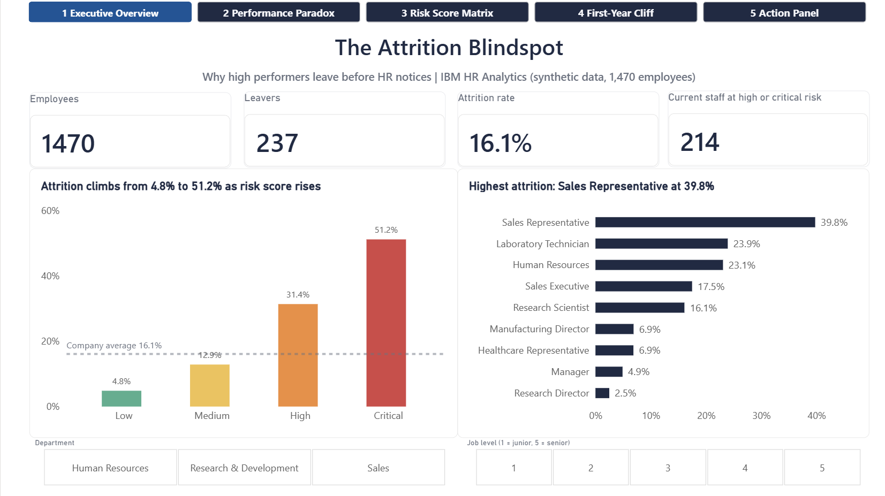
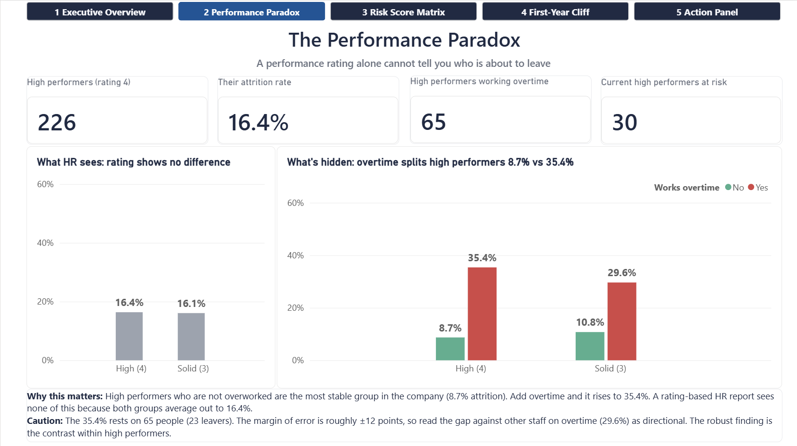
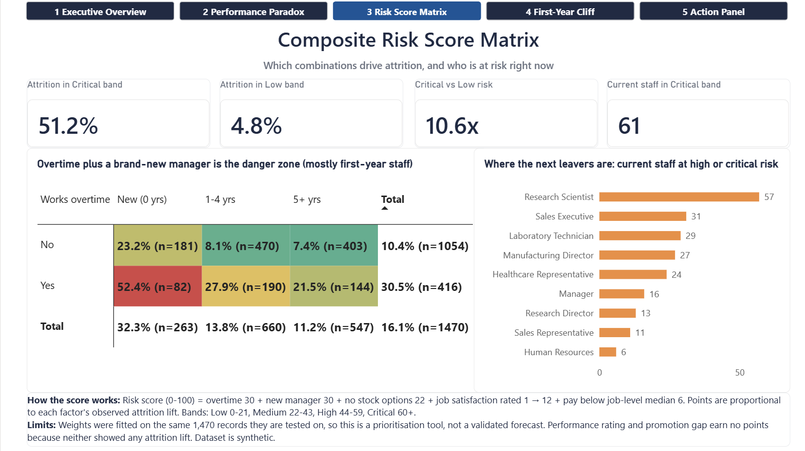
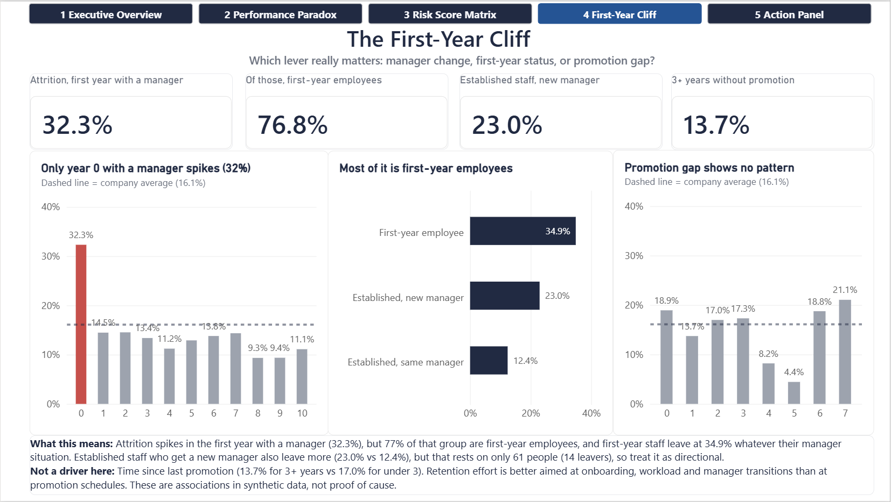
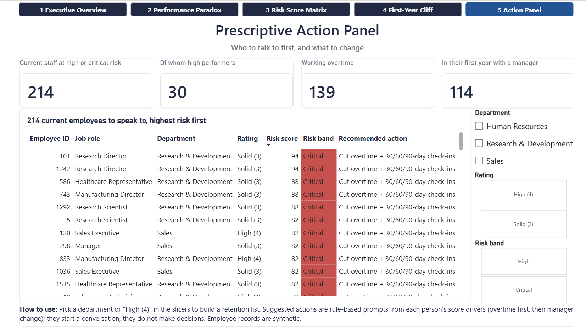

# 🔴 The Attrition Blindspot: Why High Performers Leave Before HR Notices

> **Project 03** | Power BI · DAX · PostgreSQL · IBM HR Analytics Dataset

## Business question
Which combination of performance rating, overtime, promotion history and manager tenure creates the highest attrition risk, and can a performance rating warn HR in time?

## Headline findings

| # | Finding | Evidence |
|---|---|---|
| 1 | **A performance rating carries no attrition signal.** | High performers (rating 4) leave at 16.4% vs 16.1% for everyone else (n = 226 / 1,244). |
| 2 | **The rating hides a workload split.** High performers who are *not* on overtime are the most stable group (8.7%, n = 161). With overtime it is 35.4% (n = 65). | Directional only: 23 leavers, margin of error about ±12 points. |
| 3 | **Overtime is the strongest single driver.** | 30.5% with overtime vs 10.4% without (n = 416 / 1,054). |
| 4 | **Overtime plus a brand-new manager is the danger zone.** | 52.4% attrition (n = 82), about 7x the baseline cell. |
| 5 | **The "new manager" effect is mostly a first-year-employee effect.** | 77% of staff in their first year with a manager are first-year employees. First-year staff leave at 34.9% (n = 215). Established staff with a new manager: 23.0% (n = 61) vs 12.4% with the same manager. |
| 6 | **Promotion gap does not predict attrition here.** | 13.7% for 3+ years since promotion vs 17.0% for under 3; no trend by year. Tested and rejected. |
| 7 | **A transparent 0-100 risk score separates attrition by 10.6x.** | Low band 4.8% vs Critical band 51.2%. |
| 8 | **214 current employees sit in the High or Critical bands** (30 are high performers). | The largest pool is Research Scientist (57). Sales Representatives have the highest historic attrition (39.8%) but only 11 remain at risk, because most have already left. |

## The performance paradox
Averaged together, high performers and everyone else look identical, which is exactly why rating-based HR reports see nothing. Splitting by workload shows opposite effects that cancel out: high performers are *more* stable than others when not overworked (8.7% vs 10.8%) and *less* stable when overworked (35.4% vs 29.6%). The second gap is small-sample and should be read as directional; the robust result is the contrast within high performers.

## Composite risk score
Points are proportional to each driver's observed attrition lift (percentage points, rounded so the total is 100).

| Driver | Attrition lift | Points |
|---|---|---|
| Overtime | +20.1 | 30 |
| New manager (0 yrs with current manager) | +19.7 | 30 |
| No stock options | +14.5 | 22 |
| Job satisfaction = 1 (lowest) | +8.4 | 12 |
| Pay below job-level median | +4.6 | 6 |
| High performer / promotion gap | none | 0 |

| Risk band | Score | Employees | Leavers | Attrition |
|---|---|---|---|---|
| Low | 0-21 | 516 | 25 | 4.8% |
| Medium | 22-43 | 606 | 78 | 12.9% |
| High | 44-59 | 223 | 70 | 31.4% |
| Critical | 60+ | 125 | 64 | 51.2% |

## Dashboard pages
1. **Executive Overview**: KPIs, attrition by risk band and job role, department and job level slicers
2. **The Performance Paradox**: what HR sees vs what is hidden
3. **Composite Risk Score Matrix**: overtime x manager tenure heatmap, current at-risk staff by role
4. **The First-Year Cliff**: manager tenure, first-year effect, and the rejected promotion hypothesis
5. **Prescriptive Action Panel**: ranked list of 214 current at-risk employees with rule-based suggested actions

## Method
1. **PostgreSQL**: loaded raw CSV, ran data-quality checks (1,470 rows, no nulls or duplicates, three constant columns dropped), tested thresholds against the data before fixing them, built the `hr.employees_clean` view.
2. **Threshold testing changed the design**: the planned `<= 1 year` new-manager flag was dropped to `= 0` after the data showed year 1 sits at baseline; the planned promotion-stagnation driver was removed after showing no relationship.
3. **Power BI / DAX**: calculated columns for flags, score, band and recommended action; measures for rates, cohort slices and dynamic chart titles; conditional formatting driven by a DAX colour measure.

## Links
[.png)](https://drive.google.com/file/d/1VcmbR0Km_ufdjxYmLWkPizaDmutrTWv1/view?usp=drive_link)

## Limitations (read before quoting any number)
- **Synthetic dataset** created by IBM data scientists. Findings are illustrative, not real-company evidence.
- **Score weights were fitted on the same 1,470 records they are tested on.** It is a prioritisation tool, not a validated forecast. A fair test would need a hold-out set or a second year of data.
- **Associations, not causes.** First-year status, overtime and manager change overlap.
- **Small cells:** the 35.4% high-performer-overtime rate (n = 65) and the 23.0% established-staff-new-manager rate (n = 61) are directional.
- Performance rating only contains 3 and 4 in this dataset, so "high performer" means rating 4 (15.4% of staff).
